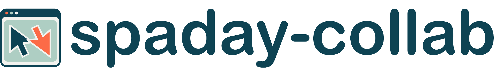

<a href="https://github.com/1kbgz/spaday-collab">
  <picture>
    <source media="(prefers-color-scheme: dark)" srcset="https://github.com/1kbgz/spaday-collab/raw/main/docs/img/logo-dark.webp?raw=true">
    
  </picture>
</a>

[](https://github.com/1kbgz/spaday-collab/actions/workflows/build.yaml)
[](https://pypi.org/project/spaday-collab/)
[](LICENSE)

Optional shared pointers and hover outlines for [spaday](https://github.com/1kbgz/spaday). Use ordinary HTML targets or supply geometry from a virtualized component.

## Install

```bash
pip install "spaday-collab[examples]"
```

## Usage

```python
from spaday import SetField, element, event_value
from spaday_collab import Pointers

page = element(
    "main",
    element("section", "Review this section", **{"data-collab-target": "review"}),
    Pointers()
    .bind("peers", "remote_pointers")
    .on("pointer-change", SetField("local_pointer", event_value("pointer"))),
)
```

A pointer is `{target, x, y}` with coordinates between zero and one. Remote entries are `{peer, pointer, label?, color?}`. The application maps scoped awareness into this list and chooses labels and colors. The included example uses Spaday's `Wire.awareness` and one transports connection for both shared data and pointers.

The browser module also exports `connectPointers`, `domTargets`, and `elementGeometry`. These work without the `Pointers` renderer or a transports connection.

## Documentation

- [Tutorial](https://1kbgz.github.io/spaday-collab/docs/src/tutorial.html): run two users against a shared note.
- [How-to guides](https://1kbgz.github.io/spaday-collab/docs/src/how-to.html): connect awareness, adapt geometry, and replace the display.
- [Reference](https://1kbgz.github.io/spaday-collab/docs/src/reference.html): Python component, browser API, and tokens.
- [Explanation](https://1kbgz.github.io/spaday-collab/docs/src/explanation.html): ownership and lifecycle boundaries.

## Browser Examples

[Open the Pyodide gallery](https://1kbgz.github.io/spaday-collab/lite/). Python creates real `Pointers` components with explicitly labeled sample peers. This single-browser preview has no shared server; use the local example for real collaboration.

## Run the examples locally

```bash
pip install "spaday-collab[examples]"
python -m spaday_collab.example
```

Open http://127.0.0.1:8044/ and http://127.0.0.1:8044/bob in separate browsers. The **Share my pointer across the page** checkbox enables a viewport fallback outside the note and review section. Over those targets, pointers follow the same content in the other browser. Focus the note or Tab to the review section to show a focus label in the other browser. Typing briefly changes that label to “Editing” while the shared note updates. Select text to show a remote highlight, or place the caret to show its position. **Share my activity** also controls page-text highlighting, transient click markers, and optional viewport progress; receiving activity never scrolls or activates controls. Demo identities are selected by URL; production applications must authenticate users and assign permissions on the server.

From a checkout, run `make develop`, `make build`, and `make test`. `make pyodide-example` builds `dist/lite`; `make test-pyodide-example` checks that preview in Chromium.

> [!NOTE]
> This library was generated using [copier](https://copier.readthedocs.io/en/stable/) from the [Base Python Project Template repository](https://github.com/python-project-templates/base).
